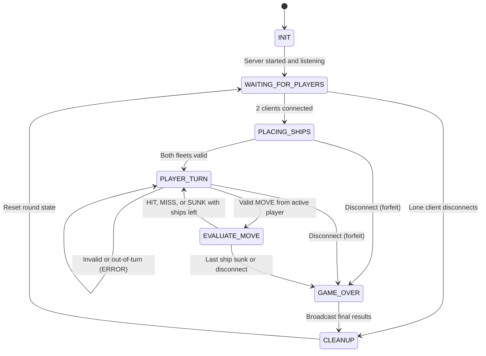

# CS 457 Project Statement of Work (SOW) & Protocol Specification

**Student Name:** Austin Reynolds
**Date:** 2026-09-23 (revised for Sprint 2)
**Course:** CS 457 - Computer Networks
**Target Server Domain:** `server.reynolds.edu`
**Git Repository:** https://github.com/AustinTaylorReynolds/cs457-networked-battleship

---

## 1. Game Selection & Scope (Sprint 0)

### 1.1 Game Overview
- **Chosen Game:** Battleship
- **Player Capacity:** 2 players (simulated via 2 CML client nodes)
- **Game Summary:** Players begin by placing their fleet on a 10x10 grid. The fleet has five ships: one 1x5, one 1x4, two 1x3, and one 1x2. Players then take turns declaring a coordinate on the opponent's grid. If the opponent has a ship on that cell, a hit is declared; otherwise a miss is declared. When every cell of a ship has been hit, that ship is sunk. Players alternate turns until one player has all of their ships sunk. That player loses and the other player wins.

### 1.2 Core Game Rules & Win/Draw Conditions
- **Turn Mechanics:** The server enforces turns, so only the active player may fire. The first player is chosen randomly by the server, and turns alternate after every valid shot. A hit does not grant an extra turn. A player cannot fire at the same cell twice.
- **Victory Condition:** The first player to have all of their ships sunk loses, and the opposing player wins.
- **Draw/Tie Condition:** There is no draw in Battleship. If a player disconnects before a victor is declared (during ship placement or battle), the remaining player **wins by forfeit**.
- **Scoring:** Two values are tracked. *Round hits* is the number of hits each player has scored in the current round. *Session wins* is the number of rounds each player has won, kept in server memory (keyed by the display name sent in `CONNECT`) until the server process exits.

---

## 2. Application-Layer Messaging Protocol Blueprint (Sprint 1 Deliverable, revised in Sprint 2)

The complete schemas, samples, and error codes are in [`docs/protocol_blueprint.md`](docs/protocol_blueprint.md). A summary follows.

### 2.1 Message Transport & Serialization Format
- **Transport Protocol:** TCP
- **Serialization Format:** JSON encoded in UTF-8
- **Framing Rule (Length-Prefixed Framing):** Every message is preceded by a 4-byte unsigned integer in network byte order (big-endian, `struct` format `!I`) giving the exact byte length of the JSON payload that follows. The receiver reads exactly 4 bytes, then loops with a `recv_exact(sock, n)` helper until exactly `N` payload bytes have been accumulated, which handles TCP fragmentation and coalescing.

#### Framing Example
- *Wire Stream Example (continuous stream):*
  `[4-Byte Length: 0x00000045 (69 bytes)] {"msg_type": "CONNECT", "player_id": "Austin", "timestamp": 1727000000} [4-Byte Length: 0x0000005C (92 bytes)] {"msg_type": "MOVE", "player_id": "Player_1", "payload": {"row": 0, "col": 2}, "timestamp": 1727000005}`
- *JSON Schema Definition (MOVE):*
  ```json
  {
    "msg_type": "MOVE",
    "player_id": "Player_1",
    "payload": { "row": 0, "col": 2 },
    "timestamp": 1727000005
  }
  ```

### 2.2 Message Schema Definitions

#### Message Types:
1. `CONNECT` (Client -> Server): Request to join the game room, carrying a display name.
2. `JOINED` (Server -> Client): Acknowledges the join and assigns the role `Player_1` or `Player_2`.
3. `LOBBY_WAIT` (Server -> Client): Notification that the server is waiting for Player 2.
4. `GAME_START` (Server -> Clients): Both players are present; begin ship placement.
5. `PLACE_SHIPS` (Client -> Server): Submits the full fleet layout (ship name, starting row/col, orientation).
6. `PLACEMENT_OK` (Server -> Client): Fleet accepted; reports whether the opponent is ready.
7. `BATTLE_START` (Server -> Clients): Both fleets placed; names the randomly chosen first player.
8. `MOVE` (Client -> Server): Active player fires at a row/col coordinate.
9. `STATE_UPDATE` (Server -> Clients): Result of the shot (`HIT`, `MISS`, or `SUNK` with ship name), fired cell, next active turn, round hits, ships remaining, and session wins.
10. `GAME_OVER` (Server -> Clients): Winner, reason (`ALL_SHIPS_SUNK` or `FORFEIT`), final hits, and session wins.
11. `ERROR` (Server -> Client): Invalid move, out-of-turn action, bad placement, wrong phase, malformed packet, or full server.
12. `DISCONNECT` (Client -> Server): Intentional departure, treated as a forfeit.

### 2.3 Game State Machine (FSM) Design (Sprint 1 Deliverable, revised in Sprint 2)
- **State Transitions:** `INIT` -> `WAITING_FOR_PLAYERS` -> `PLACING_SHIPS` -> `PLAYER_TURN` -> `EVALUATE_MOVE` -> `GAME_OVER` -> `CLEANUP` -> `WAITING_FOR_PLAYERS`. Invalid or out-of-turn messages keep the FSM in its current state and return an `ERROR`. A disconnect in `PLACING_SHIPS`, `PLAYER_TURN`, or `EVALUATE_MOVE` moves directly to `GAME_OVER` as a forfeit win. A disconnect in `WAITING_FOR_PLAYERS` goes straight to `CLEANUP`.
- The full diagram is in [`docs/fsm_specification.md`](docs/fsm_specification.md).



---

## 3. Game Behavior & Server Concurrency Architecture (Sprint 2 Deliverable)

The full analysis, shared-state table, and sequence diagrams are in [`docs/concurrency_design.md`](docs/concurrency_design.md).

### 3.1 Server Concurrency Strategy
- **Architecture Choice:** Multi-threading (`threading.Thread`). The main thread runs the `accept()` loop and spawns one daemon handler thread per client. Each handler runs a blocking receive loop built on `recv_exact`, so a slow client only blocks its own thread and the main loop stays free to accept connections (a third connection is rejected with `ERROR: SERVER_FULL`).
- **Synchronization Logic:** One global `threading.Lock` (`state_lock`) protects all shared game state: the FSM state, the client socket list, both boards, fired-cell sets, remaining ship cells, the ready set, the active turn, round hits, and session wins. Every message handler follows the same sequence: acquire the lock, validate, mutate state, broadcast, release (via `with state_lock:`). Blocking `recv` calls never happen while the lock is held, and the lock is never acquired twice by the same thread. Sends use `sendall` with a timeout and run under the lock, so frames from different threads are never interleaved and both clients see updates in the same order.

### 3.2 State & Score Synchronization Across Clients
- **Turn Enforcement:** Under the lock, the server checks that the FSM is in `PLAYER_TURN`, that the `player_id` matches the role bound to the sending socket, that the sender is the `active_turn` player, that row and col are within 0-9, and that the cell has not been fired on before. Any failure returns an `ERROR` to the sender only and leaves state unchanged. On success the server flips `active_turn` and broadcasts the new turn in a `STATE_UPDATE` to both clients.
- **Score & Board Synchronization:** Round hits, ships remaining, and session wins are updated in the same locked section as the shot result. The server sends one `STATE_UPDATE` containing the shot result and full score table to both clients before releasing the lock. At round end it broadcasts `GAME_OVER` with final hits and updated wins. Clients redraw only from these server messages, so both screens stay synchronized. The defender learns which cell was hit from the `row`/`col` fields in the same broadcast.

---

## 4. Coding & AI Implementation Plan (Sprint 3)

- **Permitted AI Tools:** Google Gemini and Claude.ai.
- **AI Prompting & Constraint Strategy:** Constrain the AI with a fixed system prompt (see [`ai_prompts.md`](ai_prompts.md)) that states the exact framing rule (4-byte `!I` length prefix, `recv_exact` accumulation loop), the JSON schemas from `docs/protocol_blueprint.md`, the 10x10 bounds check, the lock protocol from `docs/concurrency_design.md`, and the disconnect handling (EOF, `ConnectionResetError`, `BrokenPipeError`) that leads to a forfeit transition. Generated code is checked against the blueprint and FSM before it is accepted.
- **Implementation Risk Management:** [Fill in your plan, e.g. build and test framing first, then lobby, then placement, then battle, then disconnect handling, with time estimates per stage]

---

## 5. CML Multi-Subnet Topology & Wireshark Deployment Plan (Sprint 4 & 5 Deliverable)

### 5.1 Subnet & Router Design
- **Subnet A (Client 1):** `192.168.10.0/24` (Interface `Gi0/1` on Router R1)
- **Subnet B (Client 2):** `192.168.11.0/24` (Interface `Gi0/2` on Router R1)
- **Subnet C (Game Server):** `192.168.20.0/24` (Interface `Gi0/1` on Router R2)
- **Router Backbone:** `10.0.0.0/30` (Interface `Gi0/0` on R1 <-> `Gi0/0` on R2)

### 5.2 DHCP Pools & DNS Configuration Plan
- **Router R1 DHCP Pool 1 (`CLIENT1_POOL`):** Leases `192.168.10.10` - `192.168.10.50`, gateway `192.168.10.1`, DNS `10.0.0.2`.
- **Router R1 DHCP Pool 2 (`CLIENT2_POOL`):** Leases `192.168.11.10` - `192.168.11.50`, gateway `192.168.11.1`, DNS `10.0.0.2`.
- **Router R2 Authoritative DNS:** Configured with `ip dns server` and static host mapping `server.reynolds.edu` -> `192.168.20.100`.

### 5.3 Deployment Strategy & Wireshark Trace Capture
- **CML Deployment Strategy:** Deploy `server.py` onto the Subnet C node (`192.168.20.100`) behind Router R2, and `client.py` onto the Subnet A and Subnet B nodes behind Router R1.
- **Cisco Infrastructure Configuration:** Router R1 DHCP pools (`CLIENT1_POOL`, `CLIENT2_POOL`) and Router R2 authoritative DNS (`ip host server.reynolds.edu 192.168.20.100`).
- **Wireshark Trace Capture Plan:** Capture the DHCP DORA exchange (`dhcp_negotiation.pcap`) and DNS query/response resolution (`dns_lookup.pcap`).
