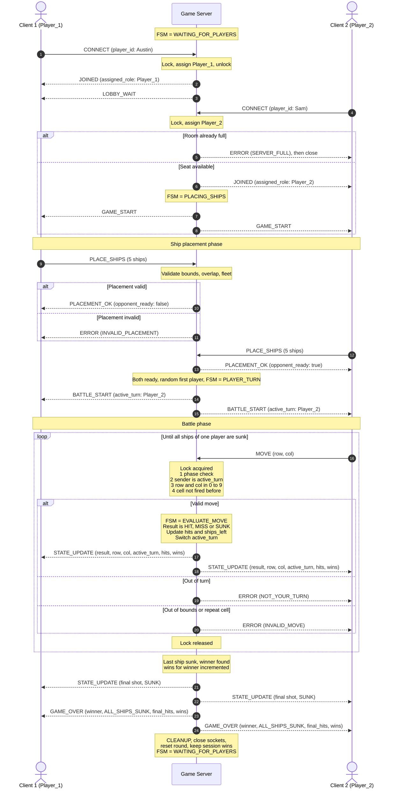
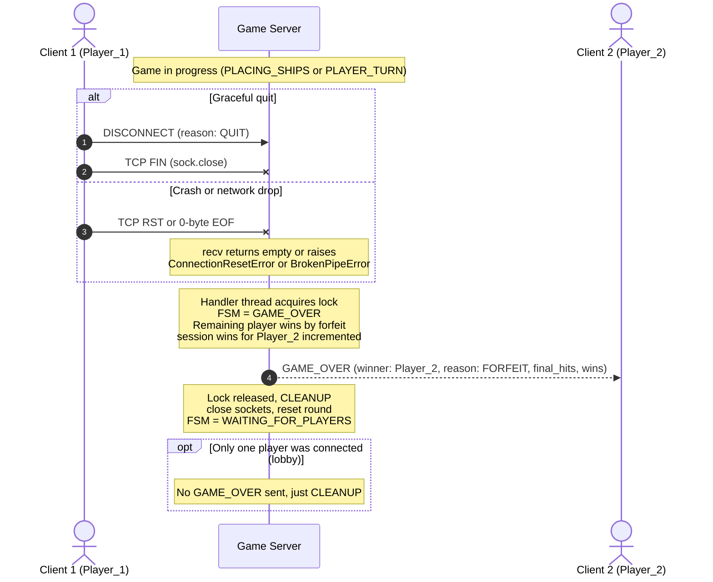

# Concurrency Design: Networked Battleship (CS 457, Sprint 2)

**Student:** Austin Reynolds
**Related docs:** [`protocol_blueprint.md`](protocol_blueprint.md), [`fsm_specification.md`](fsm_specification.md)

---

## 1. Concurrency Model Selection

**Chosen model: Option A, Multi-Threading (`threading.Thread`) with one global `threading.Lock`.**

### 1.1 Thread Layout
| Thread | Responsibility |
|---|---|
| **Main (accept) thread** | Runs `server_sock.accept()` in a loop. For each connection it spawns one handler thread. It never reads game messages, so it is never blocked by game traffic. |
| **Client handler thread** (one per connected client, daemon) | Runs a blocking receive loop: `recv_exact` the 4-byte header, `recv_exact` the payload, parse JSON, then process the message under the lock. |

With 2 players plus a possible rejected third connection, at most 3 threads exist besides main. A slow or silent client only blocks **its own** handler thread, so the server main loop stays free to accept connections. This satisfies the rubric requirement of at least 2 simultaneous clients without blocking the main loop.

### 1.2 Why threading over `selectors`
* The blocking `recv_exact` design from the protocol blueprint is used unchanged in each thread.
* `selectors` would require a per-socket receive buffer and a partial-frame state machine, which adds complexity with no benefit at 2 players.
* One lock over a tiny shared state is simple to reason about and to prove correct.

---

## 2. Shared State and Lock Ownership

All shared state lives in one `GameServer` object and is protected by **one** lock, `state_lock = threading.Lock()`.

| Shared structure | Type | Written by | Protected by |
|---|---|---|---|
| `fsm_state` | enum (`WAITING_FOR_PLAYERS`, `PLACING_SHIPS`, `PLAYER_TURN`, `GAME_OVER`, `CLEANUP`) | any handler | `state_lock` |
| `clients` | `dict[role -> ClientInfo(sock, name)]` (the client socket list) | accept/handler on join and leave | `state_lock` |
| `boards` | `dict[role -> 10x10 grid of ship ids / None]` | handler on `PLACE_SHIPS` | `state_lock` |
| `shots` | `dict[role -> set((row, col))]` cells that player has fired on | handler on `MOVE` | `state_lock` |
| `ships_left` | `dict[role -> dict[ship -> remaining cells]]` | handler on `MOVE` | `state_lock` |
| `ready` | `set[role]` players with accepted fleets | handler on `PLACE_SHIPS` | `state_lock` |
| `active_turn` | `"Player_1"` or `"Player_2"` | handler on `MOVE`, `BATTLE_START` | `state_lock` |
| `round_hits` | `dict[role -> int]` | handler on `MOVE` | `state_lock` |
| `session_wins` | `dict[player_name -> int]` | handler on `GAME_OVER` | `state_lock` |

**Not shared (no lock needed):** each handler's local receive buffer, parsed message, and loop variables.

---

## 3. Thread Safety Analysis and Lock Acquisition Strategy

### 3.1 Race conditions the lock prevents
1. **Simultaneous moves.** Both clients send `MOVE` in the same instant. Without a lock both could pass the "is it my turn?" check. With the lock, the first thread to acquire it is validated and processed, flips `active_turn`, and the second thread then sees it is not their turn and receives `NOT_YOUR_TURN`.
2. **Duplicate shot / board corruption.** Two threads mutating `shots` and `boards` could lose updates. Serialized access prevents it.
3. **Disconnect during a move.** Client 2 drops while Client 1's move is being evaluated. The disconnect handler must wait for the lock, so it sees a fully consistent state before declaring forfeit.
4. **Simultaneous joins.** Two clients connecting together could both be assigned `Player_1`. Role assignment happens inside the lock.
5. **Interleaved frames.** If two threads wrote to one socket at once, a 4-byte header and its payload could be interleaved with another message. All sends happen while holding the lock, so each frame is written atomically with respect to other writers.

### 3.2 Lock protocol (acquire, validate, mutate, broadcast, release)
Every message handler follows the same five steps:

```python
def handle_message(self, role, msg):
    with self.state_lock:                         # 1. ACQUIRE (blocks until free)
        err = self._validate_locked(role, msg)    # 2. VALIDATE phase, turn, bounds, duplicates
        if err:
            self._send_locked(role, err)          #    reply ERROR to sender only
            return                                #    lock released by `with`
        outgoing = self._apply_locked(role, msg)  # 3. MUTATE game state, build all outgoing messages
        for target, out_msg in outgoing:          # 4. BROADCAST while still holding the lock
            self._send_locked(target, out_msg)    #    so both clients see updates in the same order
    # 5. RELEASE automatically when `with` exits (also on exceptions)
```

**Rules that keep it deadlock-free and correct**
* **One lock only.** With no second lock there is no lock-ordering problem and deadlock between locks is impossible.
* **Never nest acquisition.** `threading.Lock` is not reentrant, so helpers that assume the lock is held are suffixed `_locked` and never acquire it themselves.
* **Never hold the lock while calling `recv`.** Blocking reads happen outside the lock, so a silent client can never stall the other player.
* **Always use `with state_lock:`** so the lock is released even if a send raises.
* **Sends use `sendall` with a socket timeout** (e.g. 5 s). If a send raises `ConnectionResetError`, `BrokenPipeError`, or times out, the error is caught inside `_send_locked`, the client is marked disconnected, and the forfeit path runs (still under the same lock acquisition), so a dead peer cannot hang the server.
* **Validate before mutate.** An invalid request leaves state untouched, which is how out-of-turn moves are prevented from corrupting the game.

### 3.3 Turn enforcement
Inside `_validate_locked` for `MOVE`, checks run in this order:
1. `fsm_state == PLAYER_TURN`, else `ERROR(WRONG_PHASE)`.
2. `msg["player_id"]` matches the role bound to this socket (clients cannot impersonate), else `ERROR(MALFORMED_MESSAGE)`.
3. `role == active_turn`, else `ERROR(NOT_YOUR_TURN)`.
4. `0 <= row <= 9` and `0 <= col <= 9`, else `ERROR(INVALID_MOVE)`.
5. `(row, col)` not in `shots[role]`, else `ERROR(INVALID_MOVE)`.

Only after all checks pass does the handler mutate state and switch `active_turn`.

### 3.4 Connection lifecycle inside the thread
```python
def client_loop(self, sock):
    try:
        while True:
            msg = recv_message(sock)        # recv_exact header + payload, may raise EOFError
            self.handle_message(role, msg)
    except (EOFError, ConnectionResetError, BrokenPipeError):
        pass                                # 0-byte EOF, RST, or EPIPE
    finally:
        self.handle_disconnect(role)        # takes state_lock, forfeits or cleans up
```
A third connection while two players are present gets `ERROR(SERVER_FULL)` and is closed immediately, without touching game state beyond a read of `clients` under the lock.

---

## 4. Score and Leaderboard Synchronization Design (Section 2.3)

### 4.1 How scores are stored in server memory
Scores live in the shared `GameServer` object, guarded by `state_lock`:

| Field | Scope | Meaning |
|---|---|---|
| `round_hits[role]` | Current round | Number of hits (including sinking hits) the player has scored |
| `ships_left[role]` | Current round | Remaining cells per ship, so `SUNK` and win are detected |
| `session_wins[player_name]` | Lifetime of the server process | Rounds won, keyed by the display name from `CONNECT` so a returning player keeps their total |

At `CLEANUP` the server clears `round_hits`, `boards`, `shots`, `ships_left`, `ready`, and `clients`. It **keeps** `session_wins`.

### 4.2 Broadcast logic on each shot and at round completion
After a valid `MOVE` is applied, the server builds one `STATE_UPDATE` containing shooter, `row`, `col`, `last_move_result`, `sunk_ship`, `active_turn`, `hits`, `ships_remaining`, and `wins`. It then sends **the same message to both clients** inside the same lock hold:

```python
def _broadcast_locked(self, msg):
    for role in ("Player_1", "Player_2"):       # fixed order
        self._send_locked(role, msg)
```

When the last enemy ship is sunk:
1. Increment `round_hits[shooter]`, mark the ship sunk.
2. Broadcast the final `STATE_UPDATE` (shows the last `SUNK` result and final hit counts).
3. `session_wins[winner_name] += 1`.
4. Broadcast `GAME_OVER` with `winner`, `reason: ALL_SHIPS_SUNK`, `final_hits`, and the updated `wins` table.
5. Set `fsm_state = GAME_OVER`, then run `CLEANUP` (close sockets, reset round state, return to `WAITING_FOR_PLAYERS`).

Because the update, the score increment, and both sends happen under one lock hold, no thread can observe or act on a half-updated score table, and both clients receive identical data in identical order. Each client redraws its screen only from the received message, so both screens stay synchronized.

---

## 5. State and Score Broadcast Sequence Diagram

### 5.1 Full game lifecycle (join, placement, battle, game over)



### 5.2 Disconnect and forfeit paths



### 5.3 Narrative

**Turn switches.** After `BATTLE_START`, only the player named in `active_turn` may send a valid `MOVE`. When a valid move is applied, the server, still holding `state_lock`, flips `active_turn` to the other player and includes the new value in the `STATE_UPDATE` that goes to both clients. Clients use that field to enable or disable their input prompt, so the turn indicator on both screens always comes from the same server-authored message.

**Move validation.** Every `MOVE` is checked under the lock for correct phase, sender identity, active turn, 0-9 bounds, and no repeated cell. A failure produces an `ERROR` to the sender only and changes nothing, so out-of-turn or malformed moves cannot corrupt state, and the opponent is not disturbed.

**Score updates.** Hit counts, ships remaining, and session wins are updated in the same locked section as the shot result. The resulting `STATE_UPDATE` carries the full score table, and the server sends it to both clients before releasing the lock. At round end, `GAME_OVER` carries final hits and the updated win table.

**Simultaneous broadcasts.** The broadcast helper iterates both clients while the lock is held. No other thread can mutate state or write to either socket in between, so both clients receive the same message, in the same order, derived from the same snapshot of state.

**Message coverage checklist.** `CONNECT`, `JOINED`, `LOBBY_WAIT`, `GAME_START`, `PLACE_SHIPS`, `PLACEMENT_OK`, `BATTLE_START`, `MOVE`, `STATE_UPDATE`, `GAME_OVER`, `ERROR`, and `DISCONNECT` all appear in the diagrams above.

---

## 6. Rubric Cross-Check

| Rubric item | Where addressed |
|---|---|
| At least 2 simultaneous clients without blocking the main loop | Section 1.1 (accept thread plus one handler thread per client) |
| Thread safety / mutex locking explicitly documented | Sections 2 and 3 |
| Turn enforcement prevents out-of-turn corruption | Sections 3.1, 3.3 |
| Mermaid `sequenceDiagram` covering all messages | Section 5 |
| Broadcast keeps both clients synchronized | Sections 3.2, 4.2, 5.3 |
