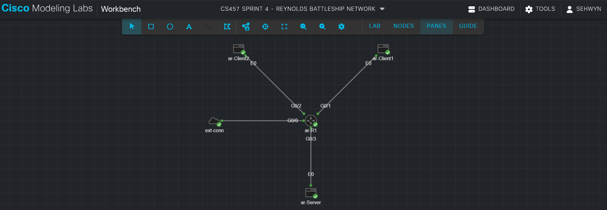
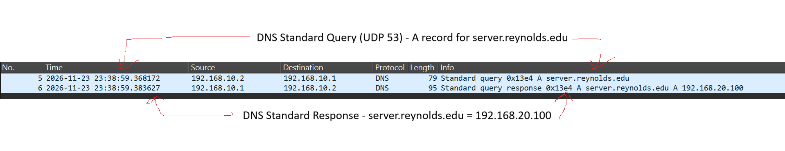

# CS 457 Sprint 4: Network Verification Report

**Student:** Austin Reynolds
**Project:** Networked Battleship
**Server FQDN:** `server.reynolds.edu` → `192.168.20.100`
**Repository:** https://github.com/AustinTaylorReynolds/cs457-networked-battleship
**Date:** 2026-11-23

Deliverables in this repository:

| Deliverable | File |
|-------------|------|
| CML topology export | [`sprint_4_topology.yaml`](sprint_4_topology.yaml) |
| Wireshark DNS capture | [`sprint_4_dns_lookup.pcap`](sprint_4_dns_lookup.pcap) |
| This report | `sprint_4_network_report.md` |

Procedure followed: [`docs/sprint_4_runbook.md`](docs/sprint_4_runbook.md).

---

## 1. Topology

A single Cisco IOSv router, **ar-R1**, connects three directly attached /24 subnets. Because every subnet is a Connected route on R1, no static or dynamic routing protocol is needed. R1 is also the DHCP server for both client subnets, the authoritative DNS server for `server.reynolds.edu`, and a PAT gateway to the CML External Connector for package installs.

| Subnet | Network | R1 interface / gateway | Host | Addressing |
|--------|---------|------------------------|------|------------|
| A | `192.168.10.0/24` | Gi0/1 `192.168.10.1` | ar-Client1 | DHCP `CLIENT1_POOL` → `192.168.10.2` |
| B | `192.168.11.0/24` | Gi0/2 `192.168.11.1` | ar-Client2 | DHCP `CLIENT2_POOL` → `192.168.11.2` |
| C | `192.168.20.0/24` | Gi0/3 `192.168.20.1` | ar-Server | Static `192.168.20.100/24` |
| Outside | `192.168.255.0/24` | Gi0/0 `192.168.255.225` (DHCP, NAT outside) | ext-conn | CML NAT |

### 1.1 CML topology screenshot



---

## 2. Router R1 configuration

`show running-config` from ar-R1 (Cisco IOSv 15.9(3)M12). Three commands from the assignment do not appear because IOS hides commands that are already at their default value. `ip routing` and `ip domain lookup` are on by default, and an interface with no `shutdown` line is up (confirmed `up/up` in §3.1).

```cisco
R1#show run
Building configuration...

Current configuration : 3958 bytes
!
! Last configuration change at 06:29:26 UTC Tue Nov 24 2026
!
version 15.9
service timestamps debug datetime msec
service timestamps log datetime msec
no service password-encryption
!
hostname R1
!
boot-start-marker
boot-end-marker
!
!
no logging console
!
no aaa new-model
!
!
!
mmi polling-interval 60
no mmi auto-configure
no mmi pvc
mmi snmp-timeout 180
!
!
!
!
!
!
!
!
ip dhcp excluded-address 192.168.10.1
ip dhcp excluded-address 192.168.11.1
!
ip dhcp pool CLIENT1_POOL
 network 192.168.10.0 255.255.255.0
 default-router 192.168.10.1 
 dns-server 192.168.10.1 
!
ip dhcp pool CLIENT2_POOL
 network 192.168.11.0 255.255.255.0
 default-router 192.168.11.1 
 dns-server 192.168.11.1 
!
!
!
ip host server.reynolds.edu 192.168.20.100
ip cef
no ipv6 cef
!
multilink bundle-name authenticated
!
!
!
!
!
redundancy
!
!
! 
!
!
!
!
!
!
!
!
!
!
!
!
interface GigabitEthernet0/0
 description Uplink to ext-conn (CML NAT 192.168.255.0/24)
 ip address dhcp
 ip nat outside
 ip virtual-reassembly in
 duplex auto
 speed auto
 media-type rj45
!
interface GigabitEthernet0/1
 description Subnet A gateway - ar-Client1
 ip address 192.168.10.1 255.255.255.0
 ip nat inside
 ip virtual-reassembly in
 duplex auto
 speed auto
 media-type rj45
!
interface GigabitEthernet0/2
 description Subnet B gateway - ar-Client2
 ip address 192.168.11.1 255.255.255.0
 ip nat inside
 ip virtual-reassembly in
 duplex auto
 speed auto
 media-type rj45
!
interface GigabitEthernet0/3
 description Subnet C gateway - ar-Server
 ip address 192.168.20.1 255.255.255.0
 ip nat inside
 ip virtual-reassembly in
 duplex auto
 speed auto
 media-type rj45
!
ip forward-protocol nd
!
!
no ip http server
no ip http secure-server
ip dns server
ip nat inside source list 1 interface GigabitEthernet0/0 overload
!
ipv6 ioam timestamp
!
!
access-list 1 permit 192.168.10.0 0.0.0.255
access-list 1 permit 192.168.11.0 0.0.0.255
access-list 1 permit 192.168.20.0 0.0.0.255
!
control-plane
!
banner exec ^C ... ^C   (IOSv evaluation banner omitted)
banner incoming ^C ... ^C   (IOSv evaluation banner omitted)
banner login ^C ... ^C   (IOSv evaluation banner omitted)
!
line con 0
 exec-timeout 0 0
 logging synchronous
line aux 0
line vty 0 4
 exec-timeout 0 0
 login
 transport input none
!
no scheduler allocate
!
end
```

---

## 3. Router R1 verification

### 3.1 `show ip interface brief`

Gi0/0 obtained `192.168.255.225` from the External Connector by DHCP. Gi0/1–Gi0/3 hold the three gateway addresses, and all four interfaces are `up/up`.

```text
R1>show ip int br
Interface                  IP-Address      OK? Method Status                Protocol
GigabitEthernet0/0         192.168.255.225 YES DHCP   up                    up      
GigabitEthernet0/1         192.168.10.1    YES TFTP   up                    up      
GigabitEthernet0/2         192.168.11.1    YES TFTP   up                    up      
GigabitEthernet0/3         192.168.20.1    YES TFTP   up                    up      
NVI0                       unassigned      YES unset  up                    up      
```

### 3.2 `show ip route`

Three Connected (`C`) routes for `192.168.10.0/24`, `192.168.11.0/24` and `192.168.20.0/24`, plus `C 192.168.255.0/24` for the uplink. The `S*` default route via `192.168.255.1` (administrative distance 254) was installed by the DHCP lease on Gi0/0. No manual `ip route` statements were needed because all three internal subnets are directly connected.

```text
R1>show ip route
Codes: L - local, C - connected, S - static, R - RIP, M - mobile, B - BGP
       D - EIGRP, EX - EIGRP external, O - OSPF, IA - OSPF inter area 
       N1 - OSPF NSSA external type 1, N2 - OSPF NSSA external type 2
       E1 - OSPF external type 1, E2 - OSPF external type 2
       i - IS-IS, su - IS-IS summary, L1 - IS-IS level-1, L2 - IS-IS level-2
       ia - IS-IS inter area, * - candidate default, U - per-user static route
       o - ODR, P - periodic downloaded static route, H - NHRP, l - LISP
       a - application route
       + - replicated route, % - next hop override, p - overrides from PfR

Gateway of last resort is 192.168.255.1 to network 0.0.0.0

S*    0.0.0.0/0 [254/0] via 192.168.255.1
      192.168.10.0/24 is variably subnetted, 2 subnets, 2 masks
C        192.168.10.0/24 is directly connected, GigabitEthernet0/1
L        192.168.10.1/32 is directly connected, GigabitEthernet0/1
      192.168.11.0/24 is variably subnetted, 2 subnets, 2 masks
C        192.168.11.0/24 is directly connected, GigabitEthernet0/2
L        192.168.11.1/32 is directly connected, GigabitEthernet0/2
      192.168.20.0/24 is variably subnetted, 2 subnets, 2 masks
C        192.168.20.0/24 is directly connected, GigabitEthernet0/3
L        192.168.20.1/32 is directly connected, GigabitEthernet0/3
      192.168.255.0/24 is variably subnetted, 2 subnets, 2 masks
C        192.168.255.0/24 is directly connected, GigabitEthernet0/0
L        192.168.255.225/32 is directly connected, GigabitEthernet0/0
```

### 3.3 `show ip dhcp binding`

One lease per pool. `192.168.10.2` went to ar-Client1 (MAC `52:54:00:ce:71:73`) and `192.168.11.2` to ar-Client2 (MAC `52:54:00:67:93:2b`). The `.1` gateway addresses were never leased because of `ip dhcp excluded-address`.

```text
R1>show ip dhcp binding 
Bindings from all pools not associated with VRF:
IP address          Client-ID/              Lease expiration        Type
                    Hardware address/
                    User name
192.168.10.2        0152.5400.ce71.73       Nov 25 2026 05:48 AM    Automatic
192.168.11.2        0152.5400.6793.2b       Nov 25 2026 05:48 AM    Automatic
```

### 3.4 `show hosts` (DNS A record)

The static entry `server.reynolds.edu → 192.168.20.100` is present (`perm, OK`). `192.168.255.1` is the upstream name server learned from the Gi0/0 DHCP lease and is used only for external names.

```text
R1>show hosts
Default domain is not set
Name/address lookup uses domain service
Name servers are 192.168.255.1

Codes: UN - unknown, EX - expired, OK - OK, ?? - revalidate
       temp - temporary, perm - permanent
       NA - Not Applicable None - Not defined

Host                      Port  Flags      Age Type   Address(es)
server.reynolds.edu       None  (perm, OK)  0   IP    192.168.20.100
```

---

## 4. Endpoint configuration

### 4.1 ar-Server (static)

Static `192.168.20.100/24`, default gateway `192.168.20.1`, resolver `192.168.20.1`.

```text
ar-Server:~$ ip addr show eth0
2: eth0: <BROADCAST,MULTICAST,UP,LOWER_UP> mtu 1500 qdisc pfifo_fast state UP qlen 1000
    link/ether 52:54:00:e9:9b:60 brd ff:ff:ff:ff:ff:ff
    inet 192.168.20.100/24 scope global eth0
       valid_lft forever preferred_lft forever
    inet6 fe80::5054:ff:fee9:9b60/64 scope link 
       valid_lft forever preferred_lft forever
ar-Server:~$ ip route
default via 192.168.20.1 dev eth0 
192.168.20.0/24 dev eth0 scope link  src 192.168.20.100 
ar-Server:~$ cat /etc/resolv.conf
nameserver 192.168.20.1
```

### 4.2 ar-Client1 (DHCP lease)

The DHCP exchange with `192.168.10.1` produced lease `192.168.10.2/24`, a default route via `192.168.10.1` (Option 3), and `nameserver 192.168.10.1` (Option 6).

```text
ar-Client1:~$ sudo ip link set eth0 up
ar-Client1:~$ sudo udhcpc -i eth0
udhcpc: started, v1.37.0
udhcpc: broadcasting discover
udhcpc: broadcasting select for 192.168.10.2, server 192.168.10.1
udhcpc: lease of 192.168.10.2 obtained from 192.168.10.1, lease time 86400
ar-Client1:~$ ip addr show eth0
2: eth0: <BROADCAST,MULTICAST,UP,LOWER_UP> mtu 1500 qdisc pfifo_fast state UP qlen 1000
    link/ether 52:54:00:ce:71:73 brd ff:ff:ff:ff:ff:ff
    inet 192.168.10.2/24 scope global eth0
       valid_lft forever preferred_lft forever
    inet6 fe80::5054:ff:fece:7173/64 scope link 
       valid_lft forever preferred_lft forever
ar-Client1:~$ ip route
default via 192.168.10.1 dev eth0  metric 202 
192.168.10.0/24 dev eth0 scope link  src 192.168.10.2 
ar-Client1:~$ cat /etc/resolv.conf
nameserver 192.168.10.1
```

### 4.3 ar-Client2 (DHCP lease)

Lease `192.168.11.2/24` from `192.168.11.1`, with a default route via `192.168.11.1` and `nameserver 192.168.11.1`.

```text
ar-Client2:~$ sudo ip link set eth0 up
ar-Client2:~$ sudo udhcpc -i eth0
udhcpc: started, v1.37.0
udhcpc: broadcasting discover
udhcpc: broadcasting select for 192.168.11.2, server 192.168.11.1
udhcpc: lease of 192.168.11.2 obtained from 192.168.11.1, lease time 86400
ar-Client2:~$ ip addr show eth0
2: eth0: <BROADCAST,MULTICAST,UP,LOWER_UP> mtu 1500 qdisc pfifo_fast state UP qlen 1000
    link/ether 52:54:00:67:93:2b brd ff:ff:ff:ff:ff:ff
    inet 192.168.11.2/24 scope global eth0
       valid_lft forever preferred_lft forever
    inet6 fe80::5054:ff:fe67:932b/64 scope link 
       valid_lft forever preferred_lft forever
ar-Client2:~$ ip route
default via 192.168.11.1 dev eth0  metric 202 
192.168.11.0/24 dev eth0 scope link  src 192.168.11.2 
ar-Client2:~$ cat /etc/resolv.conf
nameserver 192.168.11.1
```

---

## 5. Client command logs

### 5.1 ar-Client1

```text
ar-Client1:~$ ping -4 -c 4 192.168.20.100
PING 192.168.20.100 (192.168.20.100): 56 data bytes
64 bytes from 192.168.20.100: seq=0 ttl=42 time=7.819 ms
64 bytes from 192.168.20.100: seq=1 ttl=42 time=3.736 ms
64 bytes from 192.168.20.100: seq=2 ttl=42 time=4.518 ms
64 bytes from 192.168.20.100: seq=3 ttl=42 time=8.692 ms

--- 192.168.20.100 ping statistics ---
4 packets transmitted, 4 packets received, 0% packet loss
round-trip min/avg/max = 3.736/6.191/8.692 ms
ar-Client1:~$ nslookup -type=A server.reynolds.edu
Server:         192.168.10.1
Address:        192.168.10.1:53

Non-authoritative answer:
Name:   server.reynolds.edu
Address: 192.168.20.100
```

### 5.2 ar-Client2

```text
ar-Client2:~$ ping -4 -c 4 192.168.20.100
PING 192.168.20.100 (192.168.20.100): 56 data bytes
64 bytes from 192.168.20.100: seq=0 ttl=42 time=18.190 ms
64 bytes from 192.168.20.100: seq=1 ttl=42 time=5.217 ms
64 bytes from 192.168.20.100: seq=2 ttl=42 time=3.924 ms
64 bytes from 192.168.20.100: seq=3 ttl=42 time=4.460 ms

--- 192.168.20.100 ping statistics ---
4 packets transmitted, 4 packets received, 0% packet loss
round-trip min/avg/max = 3.924/7.947/18.190 ms
ar-Client2:~$ nslookup -type=A server.reynolds.edu
Server:         192.168.11.1
Address:        192.168.11.1:53

Non-authoritative answer:
Name:   server.reynolds.edu
Address: 192.168.20.100
```

**Result:** Both clients reached the Game Server at `192.168.20.100` across routed subnets with 4/4 replies and 0% packet loss. Both resolved `server.reynolds.edu` to `192.168.20.100` using R1 as their DNS server: `192.168.10.1` for Client 1 and `192.168.11.1` for Client 2.

The "Non-authoritative answer" label comes from BusyBox `nslookup`, which prints it whenever the reply does not have the DNS Authoritative Answer (AA) flag set. R1 answers this name from its own static `ip host` table, so it is the only source for the record, but IOS does not set the AA flag on those replies.

---

## 6. Wireshark DNS exchange (`sprint_4_dns_lookup.pcap`)

**Capture point:** CML link capture on ar-R1 Gi0/1 ↔ ar-Client1 eth0
**Command that generated the traffic:** `nslookup -type=A server.reynolds.edu` on ar-Client1
**Wireshark display filter:** `dns`

### 6.1 Annotated screenshot



### 6.2 Packet breakdown

| Field | ① DNS Standard Query | ② DNS Standard Query Response |
|-------|----------------------|-------------------------------|
| Frame # | <!-- TODO --> | <!-- TODO --> |
| Source IP : port | `192.168.10.2 : `<!-- TODO: client port --> | `192.168.10.1 : 53` |
| Destination IP : port | `192.168.10.1 : 53` | `192.168.10.2 : `<!-- TODO: client port --> |
| Transport | UDP | UDP |
| Transaction ID | <!-- TODO: 0x.... --> | <!-- TODO: same as the query --> |
| Flags | <!-- TODO: e.g. 0x0100 Standard query --> | <!-- TODO: e.g. 0x8180 Standard query response, No error --> |
| Question | `server.reynolds.edu: type A, class IN` | `server.reynolds.edu: type A, class IN` |
| Answer RRs | 0 | 1 |
| Answer | n/a | `server.reynolds.edu: type A, class IN, addr 192.168.20.100` |

### 6.3 Explanation

1. **Query (①).** ar-Client1 reads `nameserver 192.168.10.1` from `/etc/resolv.conf`. DHCP Option 6 put it there from `dns-server 192.168.10.1` in `CLIENT1_POOL`. Because `-type=A` was given, the client sends a single DNS Standard Query for the A record of `server.reynolds.edu` from an ephemeral UDP port to UDP port 53 on its default gateway.
2. **Response (②).** `ip dns server` makes R1 answer DNS on all of its interfaces. The name matches the static `ip host server.reynolds.edu 192.168.20.100` entry, so R1 answers from its local host table without forwarding upstream. The response echoes the query's Transaction ID and question and carries one A record: `192.168.20.100`. IOS does not set the Authoritative Answer flag on these replies, which is why `nslookup` labels the answer "Non-authoritative" even though R1 is the only source for the record.
3. **Significance.** The Battleship client (`client.py -i server.reynolds.edu`) runs the same lookup through `socket.gethostbyname()`, so this exchange is exactly what happens before the TCP connection to `192.168.20.100:8080` opens.

---

## 7. Acceptance checklist

- [x] Single router R1 connects Client 1 (`192.168.10.0/24`), Client 2 (`192.168.11.0/24`) and Game Server (`192.168.20.0/24`): §3.1, §3.2
- [x] R1 issues IP, default gateway and DNS to both clients via separate DHCP pools: §3.3, §4.2, §4.3
- [x] Game Server has static `192.168.20.100/24` with default gateway `192.168.20.1`: §4.1
- [x] `sprint_4_dns_lookup.pcap` and screenshots show `server.reynolds.edu` → `192.168.20.100`: §5, §6
- [x] Both clients ping the Game Server across routed subnets without packet loss: §5
- [x] `sprint_4_topology.yaml`, `sprint_4_dns_lookup.pcap` and `sprint_4_network_report.md` committed and the repo URL submitted on Canvas
